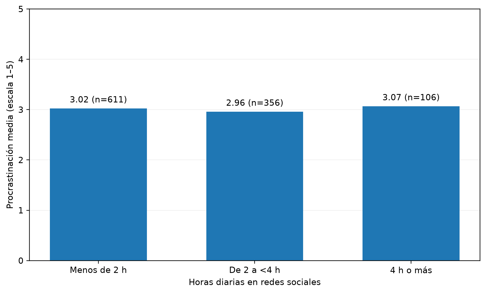
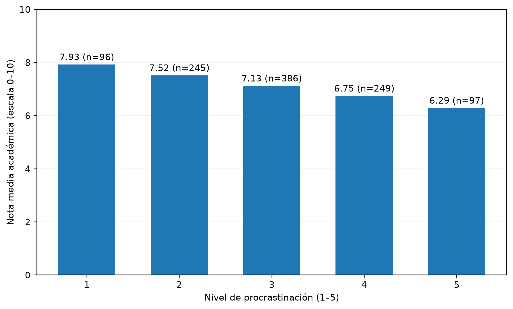
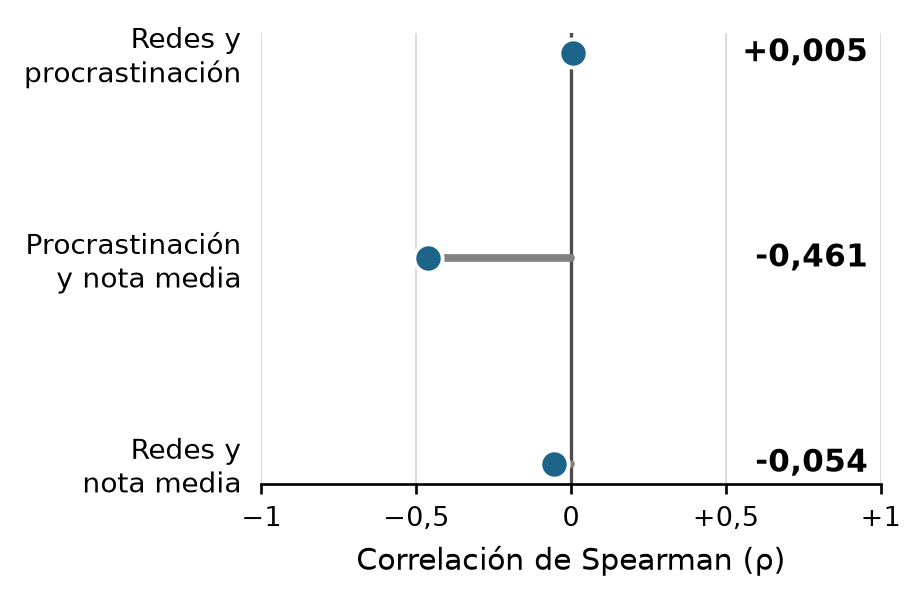

# IV. RESULTADOS

La Tabla I presenta la distribución del uso diario de redes sociales, el nivel de procrastinación y las calificaciones, agrupados por titulación. El análisis incluye 1073 observaciones completas, de las cuales 491 corresponden a ADET y 582 a Ingeniería Informática (INF).

**TABLA I. DISTRIBUCIÓN DE LAS VARIABLES PRINCIPALES POR TITULACIÓN**

| Variable / categoría | ADET (n=491) | INF (n=582) |
|---|---:|---:|
| Redes: menos de 2 h | 278 (56,6 %) | 333 (57,2 %) |
| Redes: de 2 a <4 h | 165 (33,6 %) | 191 (32,8 %) |
| Redes: 4 h o más | 48 (9,8 %) | 58 (10,0 %) |
| Procrastinación: nivel 1–2 | 156 (31,8 %) | 185 (31,8 %) |
| Procrastinación: nivel 3 | 167 (34,0 %) | 219 (37,6 %) |
| Procrastinación: nivel 4–5 | 168 (34,2 %) | 178 (30,6 %) |
| Calificación: inferior a 5 | 6 (1,2 %) | 5 (0,9 %) |
| Calificación: 5 o superior | 485 (98,8 %) | 577 (99,1 %) |

*Nota.* Se muestran frecuencias absolutas n y porcentajes calculados dentro de cada titulación. Las categorías de procrastinación 1–2, 3 y 4–5 son agrupaciones descriptivas. Datos simulados de la asignatura.

Se calcularon correlaciones de Spearman en las 1073 observaciones completas: horas en redes y procrastinación (ρ = 0,005), procrastinación y nota media (ρ = -0,461) y horas en redes y nota media (ρ = -0,054).

La Fig. 1 presenta el promedio de procrastinación de los estudiantes distribuidos en tres intervalos de uso diario de redes sociales.

*Fig. 1. Procrastinación media según las horas diarias de uso de redes sociales. Datos simulados. Las etiquetas indican media y número de registros.*

La Fig. 2 presenta la nota media académica correspondiente a cada uno de los cinco niveles de procrastinación.

*Fig. 2. Calificación media según el nivel de procrastinación académica. Datos simulados. Las etiquetas indican media y número de registros.*

La Fig. 3 recoge los tres coeficientes de Spearman calculados con las mismas 1073 respuestas completas. El coeficiente entre horas en redes y procrastinación fue de 0,005, entre procrastinación y nota media fue de -0,461, y entre horas en redes y nota media fue de -0,054.

*Fig. 3. Coeficientes de correlación de Spearman entre las variables principales. Datos simulados (n = 1073).*
